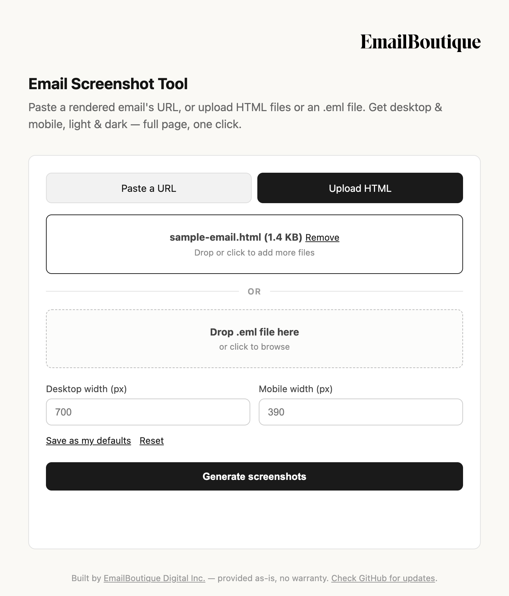

# Email Screenshot Tool

Built by [EmailBoutique Digital Inc.](https://emailboutique.io) ·
[GitHub repo](https://github.com/Annett/email-screenshot-tool) for the latest
version and updates.

Give it a rendered email — a URL, an HTML file, or an `.eml` file — and get four
full-page screenshots in one click: desktop/mobile × light/dark mode. No
scrolling, no manual stitching, no DevTools required — great for building out a
portfolio or case study fast.



It is a **portfolio screenshot tool first** and a developer utility second:
Portfolio Mode is the default and shows just the four screenshots and the
download buttons; Developer Mode adds technical detail about the email.

## Contents

- [What you can give it](#what-you-can-give-it)
- [Portfolio Mode](#portfolio-mode)
- [Developer Mode](#developer-mode)
- [Browser dark mode is not inbox-client rendering](#browser-dark-mode-is-not-inbox-client-rendering)
- [Setup](#setup)
- [Using `.eml` files](#using-eml-files)
- [Screenshot widths](#screenshot-widths)
- [Privacy and security](#privacy-and-security)
- [How it works](#how-it-works)
- [API](#api)
- [Configuration](#configuration)
- [Troubleshooting](#troubleshooting)
- [Disclaimer](#disclaimer)

## What you can give it

Use **one** of these per run:

| Input | How |
|---|---|
| **A URL** | "Paste a URL" tab — any rendered email or web page reachable from your machine (ESP preview, CMS, staging, local dev server). |
| **HTML files** | "Upload HTML" tab — drag one **or several** `.html` / `.htm` files onto the **Drop .html files here** box (or click the box to browse). See [Several HTML files at once](#several-html-files-at-once). |
| **An `.eml` file** | Drag it onto the **Drop .eml file here** box (or click the box to browse). |

Choosing an `.eml` clears the URL / HTML input, and typing a URL or picking an
HTML file clears the `.eml` — only one source is ever used.

### Several HTML files at once

Drop or pick as many as 20 HTML files and the tool renders them one after
another (roughly 7 seconds each), with progress shown as "Rendering 2 of 5: …".

- The files you drop are **added** to the list, never replacing it. Duplicates are
  ignored, files that aren't HTML are skipped with a message, and each file has
  its own **Remove** link (or **Remove all**).
- Results are **grouped by email**, headed by the file name. Each group has its
  four screenshots with Download and View buttons, its own **Download .zip**, and
  its own notes and Developer Mode panel.
- The main **Download all (.zip)** button gives you one zip with a **folder per
  email**: `newsletter/desktop-light.png`, `newsletter/mobile-dark.png`, and so on.
  Two files with the same name get separate folders (`email`, `email-2`).
- **One bad file doesn't stop the rest.** A file that can't be rendered shows its
  error in its own group; the others complete and are included in the zip.
- Width settings apply to every file in the batch. `.eml` files and URLs are still
  one at a time.

## Portfolio Mode

The default view, and the main purpose of the tool. It produces clean,
consistent screenshots of the email's *intended* design:

- Desktop — Light
- Desktop — Dark
- Mobile — Light
- Mobile — Dark

Each one is a full-page PNG (the whole email, top to bottom) with its own
download button and a **View** button beside it that opens the full-size
screenshot in a new tab, plus **Download all (.zip)** for all four at once.

> Clean, consistent screenshots showing the intended light and dark mode design.
> Browser-based rendering; not an inbox-client simulation.

Screenshots are deliberately labelled just "Desktop — Light" etc. — never
"Gmail Dark Mode", "Outlook Dark Mode" and so on, because that is not what the
tool renders (see [below](#browser-dark-mode-is-not-inbox-client-rendering)).

Use them in portfolios, case studies, presentations, documentation and client
work.

## Developer Mode

Flip the **[ Portfolio ] [ Developer ]** toggle above the results. The
screenshots stay the same; the dark ones are labelled **Browser Dark Mode
Preview**, and a panel of technical information appears below them. It is read
from the email's source or measured while rendering. The one inference is the ESP,
which is matched from known patterns and shown with its evidence and a confidence
level:

- **Subject & preheader** — the subject line (`.eml` only) and the preheader:
  the hidden preview text at the top of the email if there is one, otherwise the
  first text in the body, which is what inboxes will preview. Character counts
  are shown. Inbox apps show different amounts of both, so no pass/fail is given.
- **Source** — where the email came from. For `.eml` files: From, To, Cc,
  Reply-To, Date, Message-ID, Return-Path, List-Unsubscribe, X-Mailer, whether
  it had an HTML body, inline (CID) image count, and a list of attachments.
- **Deliverability** (`.eml` only) — see [below](#deliverability-eml-files-only).
- **Dark Mode Support** — which of these techniques the HTML contains:
  `@media (prefers-color-scheme: dark)`, `<meta name="color-scheme">`,
  `<meta name="supported-color-schemes">`, Outlook `[data-ogsc]` and
  `[data-ogsb]` targeting.
- **HTML** — size of the email's HTML (with a note when it is over Gmail's
  roughly 102 KB clipping point).
- **Images** — number of `` elements; remote, embedded (`data:`) and CID
  counts; CID references that don't exist in the `.eml`; images that failed to
  load (with URL and reason); requests that were blocked; images missing `width`
  or `height` attributes; images **without an `alt` attribute** (an empty
  `alt=""` is counted separately as decorative, which is valid); images **over
  200 KB**, with their sizes; and the total image weight. The 200 KB line is a
  common rule of thumb for email, not a hard limit. Sizes are what was
  downloaded (or embedded in the `.eml`); CSS background images aren't included.
- **Structure** — approximate container width (the widest fixed pixel width
  declared on a table/div/td), width-based `@media` queries and their
  breakpoints, and how many tables use `role="presentation"`.

The Dark Mode Support list is **diagnostic information, not a grade**. "Not
detected" is not an error: some techniques are optional, and some are only
relevant to particular clients.

Limits of the analysis: it looks at the email's own HTML, including `<style>`
blocks. It does not follow linked stylesheets, and "container width" is only
shown when the HTML declares a fixed width it can read.

### Deliverability (`.eml` files only)

For `.eml` uploads, Developer Mode adds a **Deliverability** section. A **Needs
attention** list at the top collects anything that isn't right (in red); below it:

- **Email service provider (ESP)** — which ESP sent the email (Klaviyo,
  SendGrid, Mailchimp, Amazon SES, HubSpot and about thirty others), recognised
  from known patterns in the headers (Return-Path, DKIM signing domain,
  List-Unsubscribe, Message-ID, ESP-specific `X-` headers, `X-Mailer`) and the
  links in the HTML. The evidence is listed with a confidence level (high /
  likely / possible). If nothing matches, it says so — that does not mean no ESP
  was used, only that it isn't in the tool's list.
- **As recorded when the email was delivered** — the SPF, DKIM and DMARC results
  the *receiving* mail server wrote into the email's `Authentication-Results`
  header (falling back to `Received-SPF`), including which domain was checked,
  whether it lines up with the From domain, and the DMARC policy. Anything that
  isn't a pass is flagged, and a warning appears if neither SPF nor DKIM passed in
  alignment with the From domain (DMARC needs one of them).
- **The sender's DNS records (checked just now)** — a live lookup of:
  - **SPF**: the record exists, there is exactly one, how many of the allowed 10
    DNS lookups it uses, and how it ends (`-all`, `~all`, `?all`, `+all`).
  - **DMARC**: the record exists (on the From domain or its parent domain), is
    valid, and what the policy is (`none` is reported as monitoring-only, not as
    an error).
  - **DKIM**: for each `DKIM-Signature` in the email, the public key exists, has
    not been revoked (empty `p=`), and its strength (under 1024-bit is flagged,
    1024-bit noted, 2048-bit fine).

What to keep in mind:

- The tool **does not re-verify** SPF, DKIM or DMARC itself. The first list is
  the receiving server's verdict *at delivery time*; the DNS list checks that the
  sender's records exist and look sensible *today*. They can legitimately differ
  (DNS may have changed since the email was sent).
- It depends on the file. An email saved from a **Sent** folder, exported by a
  tool that strips headers, or **forwarded** (which can break SPF for legitimate
  reasons) may have no or different authentication results. When there are none,
  the section says so — that is not treated as a failure.
- If DNS can't be reached (offline, blocked), those rows say **"couldn't be
  checked"** rather than reporting a record as missing.
- Alignment is compared at the organisational-domain level (relaxed alignment),
  which is how DMARC works by default.

## Browser dark mode is not inbox-client rendering

**The dark screenshots are a browser preview, not what Gmail, Outlook or Apple
Mail will show.**

**What it represents.** The tool switches on `prefers-color-scheme: dark` in a
headless Chrome. So it shows the dark-mode styles the email's author wrote —
the `@media (prefers-color-scheme: dark)` rules, `color-scheme` handling, dark
image swaps and so on — exactly as a browser would apply them.

**What it does NOT represent.** Email clients do their own things on top of (or
instead of) that:

- Some clients **force-invert or recolor** an email's colors when the reader is
  in dark mode — including emails that have no dark-mode styles at all. Those
  automatic color transformations are not reproduced here, and they differ
  between clients, apps and versions.
- Outlook variants use their own dark-mode mechanisms (the `[data-ogsc]` /
  `[data-ogsb]` attributes the diagnostic looks for). The tool detects that
  code, but does not apply Outlook's transformation.
- Clients differ in what CSS they support or strip, how they handle images,
  backgrounds and logos, and how they lay out narrow screens.

So use these screenshots to show the **intended design** of your email. Do not
present them as proof of how a particular inbox renders it, and test in real
email clients (Apple Mail, Gmail, Outlook, etc.) before a send.

## Setup

**Requirements:** Node.js 18 or newer.

```bash
npm install
npm start
```

Then open **http://localhost:4747** in your browser and leave the terminal
window running while you use the tool. (`npm install` also downloads the
Chromium browser the tool uses to render; that can take a minute the first time.)

`.eml` parsing uses [`mailparser`](https://www.npmjs.com/package/mailparser).
Rendering uses [Puppeteer](https://pptr.dev). ZIP downloads use
[`archiver`](https://www.npmjs.com/package/archiver).

## Using `.eml` files

An `.eml` file is a saved copy of a whole email. Most email apps can export one
(exact menu names vary by app and version):

- **Gmail:** open the message → ⋮ menu → **Download message**
- **Apple Mail:** select the message → **File → Save As…** (or drag it to the Desktop)
- **Thunderbird:** **File → Save As → File…**

Outlook's older `.msg` format is not supported — export or save as `.eml`
instead.

What the tool reads from an `.eml`:

- the **HTML body**, rendered in a clean browser page
- **subject, From and the other useful headers** (shown in Developer Mode)
- **inline (CID) images** — embedded so they show up in the screenshots
- **attachments** — listed by name, type and size in Developer Mode only; they
  are never opened, rendered or saved

What happens in the edge cases:

| Situation | Result |
|---|---|
| No HTML part, only plain text | The plain-text version is rendered in a simple page (with a light and dark style) and a notice explains that. |
| No readable body at all | A clear error message. |
| A CID image the email references but doesn't contain | Left as a broken image; a warning and the Developer Mode list tell you which one. |
| A remote image that can't be loaded (dead link, no network) | The screenshot shows a broken image; a warning says how many. |
| Not an email (wrong contents, binary file, empty file, `.msg`) | A plain-English error instead of a crash. |
| File over 25 MB | A "file too large" message. |

Malformed HTML is rendered the way a browser renders it.

## Screenshot widths

Consistency matters across a portfolio, so the widths are fixed rather than
"wherever the window happened to be":

| | Default |
|---|---|
| Desktop | 700 px |
| Mobile | 390 px |

Change them in the **Desktop width** / **Mobile width** boxes (200–3840 px).
**Save as my defaults** remembers your numbers in that browser (its local
storage — nothing is sent anywhere), and **Reset** goes back to the built-in
sizes. Leave a box empty to use the default.

Only the width is fixed. Screenshots always capture the **complete email
vertically**, however long it is. (If an email's content is wider than the
viewport — a fixed-width image on mobile, for instance — the screenshot is as
wide as the content, exactly like scrolling sideways in a browser would show.)

## Privacy and security

**Everything runs on your machine.** Emails and screenshots are not sent to
EmailBoutique or any other service. Two kinds of network requests do happen, both
described below: the remote images an email references, and — for `.eml` files —
DNS lookups for the sender's domains. Screenshots are written to `output/`
(gitignored) and served back to your browser for download. Old screenshot files
in `output/` are deleted automatically after 24 hours; uploaded files are held in
memory only and never written to disk.

**Treat `.eml` files as untrusted.** They can contain arbitrary HTML from
arbitrary senders. The tool handles them like this:

- The email is rendered in its **own headless Chrome page** and only a PNG comes
  back. The email's HTML is never put into the tool's own page, so it cannot
  touch the interface. Everything shown from an email (subject, headers, file
  names) is displayed as plain text.
- **JavaScript is turned off** for uploaded HTML and `.eml` content, like in an
  inbox.
- Requests the email makes are checked: anything aimed at **private or local
  network addresses** (localhost, `10.x`, `192.168.x`, `172.16–31.x`, link-local
  and cloud-metadata addresses, IPv6 equivalents, and hostnames that resolve to
  them) is **blocked**, as are non-web URL schemes such as `file:`.
- Uploads are limited to 25 MB and must have an `.eml` (or `.html` / `.htm`)
  extension.

**What this does *not* protect you from — worth knowing:**

- **DNS lookups for `.eml` files.** To check the sender's SPF, DKIM and DMARC
  records, the tool looks up DNS TXT records for the domains in the email's From,
  Return-Path and DKIM-Signature headers, using your computer's normal DNS
  resolver. Your DNS provider can therefore see those domain names. Only DNS
  records are requested (at most about 30 lookups per email); the tool does not
  connect to those domains' servers, and it validates each name before looking it
  up.
- **Remote images are fetched from the internet** (otherwise the screenshots
  would be missing images). That includes **tracking pixels**: rendering an email
  can make a request that tells the sender the email was "opened" from your
  network. Use emails you are comfortable loading.
- The private-address check happens when Chrome makes each request. It is a
  sensible guard for a local tool, not a hardened sandbox — a hostile server that
  changes its DNS answer between the check and the connection could get around
  it. Don't process emails from sources you'd never open in a browser.
- **URL mode** fetches whatever address *you* type — including `localhost` and
  intranet pages (handy for local dev servers) — so the private-address block
  applies to uploaded content, not to URLs you enter yourself.

**The tool is local-only by design.** The server listens on `127.0.0.1` only,
and it rejects requests whose `Host` or `Origin` isn't localhost, which protects
against other websites in your browser trying to drive it. Don't expose it to a
network (see the [disclaimer](#disclaimer)).

## How it works

The server (`server.js`) drives a real headless Chrome via
[Puppeteer](https://pptr.dev):

1. It renders your URL, or your uploaded HTML / the HTML extracted from the
   `.eml` (`page.setContent`), in a fresh page per screenshot.
2. It emulates the `prefers-color-scheme` media feature
   (`page.emulateMediaFeatures`) to force light or dark — so the email's
   `@media (prefers-color-scheme: dark)` CSS fires as it would in a browser.
3. It sets the viewport to the desktop or mobile width, waits briefly for
   webfonts/images to settle, then captures the *entire* scrollable page as one
   PNG (`fullPage: true`).

That's four screenshots — desktop/light, desktop/dark, mobile/light,
mobile/dark — defined in the `VARIANTS` array at the top of `server.js`. Jobs are
processed one at a time (extra requests wait their turn), because parallel renders
slow each other down and can hit the per-page timeout.

For `.eml` files, [`mailparser`](https://www.npmjs.com/package/mailparser)
extracts the HTML, headers and attachments, and CID images are inlined as
`data:` URIs so they render without any network access.

## API

Two endpoints, if you want to script against it instead of using the UI:

- `POST /generate` — multipart form with **exactly one** of `url`, `htmlFile`
  or `emlFile`, plus optional `desktopWidth` / `mobileWidth` (integers,
  200–3840). Returns JSON:
  - `jobId`, `source` (`url` | `html` | `eml`), `widths`
  - `images` — `{ <variant>: { label, href } }`; files are served at `href`
  - `diagnostics` — dark-mode checks, HTML size, image and structure details
  - `preview` — `subject` and `preheader` (`{ text, source, length }`)
  - `email` — subject, headers, attachments and `deliverability` (ESP, recorded
    authentication results, DNS record checks and findings) — `.eml` only;
    otherwise `null`
  - `warnings` — human-readable notes (missing images, blocked requests, …)

  Errors come back as `{ "error": "…" }` with a 4xx/5xx status.
- `GET /download-all/:jobId` — streams a zip of that job's four PNGs.
- `GET /download-batch?j=<jobId>.<name>&j=<jobId>.<name>…` — streams one zip for
  several jobs, with a folder per job named after `<name>` (URL-encoded; the
  extension and any unsafe characters are removed). At most 50 jobs.

Each `POST /generate` still renders one source; the page sends one request per
HTML file, in order.

Requests must come from localhost (see [Privacy and security](#privacy-and-security)).

## Configuration

- **Viewport widths**: change them per run in the UI, or change the defaults in
  the `VARIANTS` array in `server.js` (add more variants — e.g. a tablet width —
  the same way).
- **Port**: defaults to `4747`. Override with `PORT=<number> npm start`.
- **Host**: defaults to `127.0.0.1` (this machine only). `HOST=<address>`
  changes it, but read the [disclaimer](#disclaimer) first.

## Troubleshooting

- **"This site can't be reached"** — the server isn't running, or crashed.
  Run `npm start` again in the project folder and leave that terminal window
  open while you use the tool.
- **`Error: listen EADDRINUSE: address already in use :::4747`** — something
  is already listening on port 4747 (maybe an earlier `npm start`). Find and
  stop it: `lsof -nP -iTCP:4747 -sTCP:LISTEN`, then `kill <PID>` from the
  output, wait a couple of seconds, and run `npm start` again. Or use another
  port: `PORT=4848 npm start`. The server stops on Ctrl+C, on a normal `kill`,
  and when its terminal window is closed; a server left over from an older
  version of the tool ignored a normal `kill`, so use `kill -9 <PID>` for that one.
- **"The browser stopped unexpectedly" / `Connection closed`** — the headless
  Chrome died (for example after a dependency reinstall while the server kept
  running). The tool relaunches it on the next attempt, so just click **Generate**
  again; if it keeps happening, stop the server (`Ctrl+C`) and run `npm start`.
- **Images are missing from a screenshot** — check the warning under the
  Generate button and the **Images** section in Developer Mode: it lists images
  that failed to load (dead links, no network) and requests that were blocked
  because they pointed at a private/local address.
- **"That doesn't look like a valid .eml file"** — the file has no email
  headers. Re-export it from your email app as `.eml`; Outlook `.msg` files
  aren't supported.
- **"This .eml has no readable body"** — the message has neither an HTML nor a
  plain-text part (for example, headers only).
- **Embedded (CID) images don't show** — the email refers to an image that isn't
  inside the `.eml` (some exports drop them). Developer Mode lists the missing
  `cid:` references.
- **"No authentication results were found in this .eml"** — the file has no
  `Authentication-Results` header (saved from a Sent folder, exported without
  full headers, or never passed through a server that records results). Export
  the message again from the *receiving* mailbox, as raw source / `.eml`.
- **DNS rows say "couldn't be checked"** — the tool couldn't reach a DNS server
  (offline, VPN, or a blocked resolver). The email itself is fine; try again when
  the connection is back.
- **"That file is larger than 25 MB"** — export the email without large
  attachments, or use the HTML file instead.
- **A URL takes too long or fails** — there's a 30 second limit per screenshot;
  check that the page's images and stylesheets are reachable from your machine.
- **Nothing happens after clicking "Generate screenshots"** — check the terminal
  running `npm start` for errors; the page's status line also shows the specific
  failure.

## Disclaimer

This is an internal EmailBoutique tool, shared as-is under the MIT license
(see `LICENSE`) — no warranty, no guarantee of fitness for any particular
purpose, and no ongoing support commitment. In particular:

- It is a **local tool, not a hosted service**. It will fetch whatever URL or
  render whatever HTML or `.eml` you give it, with no sandboxing beyond what
  Puppeteer/Chrome do by default plus the safeguards described above. Don't
  point it at untrusted URLs, and be careful with emails from untrusted senders.
- **Do not deploy this as-is on the public internet.** Doing so exposes an
  open door for someone to point it at internal/malicious URLs (SSRF) or
  exhaust resources by spamming requests (each one spins up a real headless
  Chrome instance). Add authentication, rate limiting, and URL validation
  first if you host it anywhere reachable by others.
- Screenshot accuracy depends on Puppeteer's bundled Chromium. It's a close,
  practical approximation of a browser's rendering of the email's intended
  design — **not** a simulation of how Gmail, Outlook, Apple Mail or any other
  client will display it, and not a substitute for testing in those clients
  before a real send.

## License

MIT — see [LICENSE](LICENSE).
